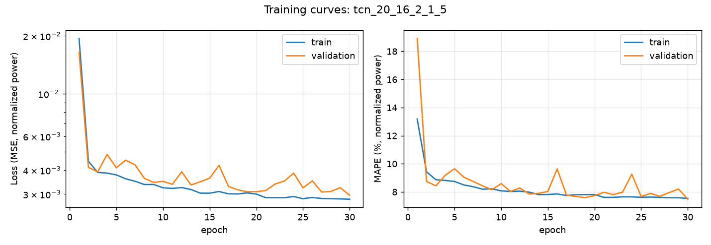
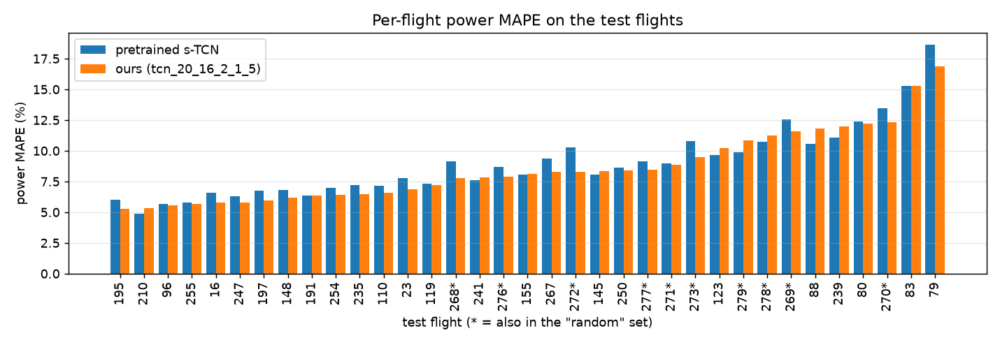
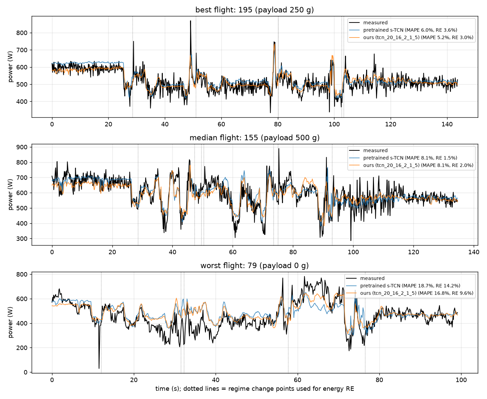

# Deep Energy Model — PyTorch port

A PyTorch port of the TCN and LSTM energy models from
[castacks/cvar-energy-risk-deep-model](https://github.com/castacks/cvar-energy-risk-deep-model)
(Choudhry, Moon, Patrikar et al., ICRA 2021). The original Keras code and README are kept below.

The converted pretrained models reproduce the original Keras outputs (max difference < 4e-7)
and the paper's power MAPE.

## Setup

```bash
conda create -n idl_project python=3.12 -y
conda activate idl_project
pip install -r <(grep -v keras-tcn requirements-torch.txt)
pip install --no-deps keras-tcn==3.1.1   # only needed for port_weights.py --verify
```

Without conda, a venv with any Python ≥ 3.12 works (3.10 cannot install the pinned numpy). On a machine
without a GPU, the CPU build of torch is a much smaller download:

```bash
python3.13 -m venv .venv && source .venv/bin/activate
pip install --extra-index-url https://download.pytorch.org/whl/cpu -r <(grep -vE 'keras-tcn|tensorflow|tf-keras' requirements-torch.txt)
```

Get the dataset (once): `python train_torch.py -D --total_epochs 0`, which downloads and unzips it into `./data/`.

The TCNs train fine on a CPU: the 30-epoch s-TCN below took about 10 minutes on 8 cores. The stateful LSTMs
(batch size 1) are slow on any hardware.

## Commands

| Command | What it does |
|---|---|
| `python evaluate_torch.py` | Scores the pretrained b-TCN on the test flights: power MAPE % / energy error RE %. |
| `python evaluate_torch.py -m all -e random test` | Reproduces the paper's table for all four pretrained models and physics model. |
| `python evaluate_torch.py -m liu -e random test` | Scores the Liu physics model (the paper's baseline, with the authors' fixed constants). `-m all` includes it. |
| `python evaluate_torch.py -m s-TCN Results/ckpts/<run>/final.pt -e random test` | Compares your own trained checkpoint with a pretrained model. |
| `python train_torch.py` | Trains a TCN with the default settings (32 filters, kernel 3, 4 layers, 10 epochs). |
| `python plot_results.py -c Results/ckpts/<run>/final.pt -p s-TCN --out docs/<run>` | Training curves, per-flight test MAPE and example flights for a checkpoint vs a pretrained model. |
| `python port_weights.py` | Converts the Keras checkpoints in `models/` to `models_torch/*.pt`. Already done; needs TensorFlow. |
| `python port_weights.py --verify` | Also runs the original Keras model and prints the max output difference. |

### Training the paper's models

```bash
# s-TCN (use --nb_filters 64 for b-TCN)
python train_torch.py --nb_filters 16 --kernel_size 2 --n_layers 5 --total_epochs 30

# s-LSTM (use --units 64 for b-LSTM); slow, because batch size 1 is sequential
python train_torch.py --net_type lstm --units 16 --n_hidden 3 --optimizer RMSprop --stateful --batch_size 1
```

Each run writes to `Results/` (named after its settings, e.g. `tcn_20_16_2_1_5`):
- `ckpts/<run>/epoch_XXXX.pt` every `--save_every` epochs, plus `final.pt`
- `CsvResults/<run>/csv_result.csv` with per-epoch train/validation loss, RMSE and MAPE

The MAPE in the training log is on normalized power. Use `evaluate_torch.py` for numbers comparable to the paper.

### Useful options

| Option | Script | Meaning |
|---|---|---|
| `-m` | evaluate | Model names (`b-TCN`, `s-TCN`, `b-LSTM`, `s-LSTM`, `liu`, `all`) or `.pt` paths |
| `-e` | evaluate | Flight sets: `train`, `val`, `test`, `random`, `all`, or a held-out split name (its test flights) |
| `--split` | train | `random` (paper), `payload500`, `payload250`, `speed12`, `alt100`, `route`; see [Held-out splits](#held-out-splits) |
| `--net_type` | train | `tcn` or `lstm` |
| `--nb_filters`, `--kernel_size`, `--n_layers`, `--nb_stacks` | train | TCN size (dilations 1, 2, …, 2^(n_layers−1)) |
| `--units`, `--n_hidden`, `--stateful` | train | LSTM size, number of layers, carry state across batches |
| `--total_epochs`, `--batch_size`, `--optimizer`, `--dropout` | train | Training settings (optimizer: `Adam`, `RMSprop`, `SGD`) |
| `--save_every`, `--seed`, `--device` | train | Checkpoint interval, random seed, `cuda` or `cpu` |
| `-d`, `-o` | both | Data directory and output directory (default `./`) |

## Files

| File | Contents |
|---|---|
| `torch_model.py` | The model (`DeepEnergyModel`, TCN, residual block) and the pretrained configs |
| `torch_data.py` | Turns flights into tensors, batching, prediction, metrics |
| `train_torch.py` | Training script (PyTorch version of `train.py`) |
| `evaluate_torch.py` | Evaluation script (PyTorch version of `evaluation.py`) |
| `port_weights.py` | Keras checkpoint → PyTorch converter |
| `plot_results.py` | Figures and per-flight metrics for a trained checkpoint (the baseline results below) |
| `splits.py` | Train/val/test splits, including the held-out operating-condition splits (`python splits.py` prints them) |
| `models_torch/` | The four converted pretrained models |
| `docs/baseline/` | Figures, `per_flight_metrics.csv` and `train_log.txt` for the 30-epoch s-TCN baseline |

## Baseline results: s-TCN, 30 epochs

Trained from scratch with the paper's s-TCN settings (seed 0, Adam lr 1e-3, batch 32, lookback 20, 5,225 parameters, 114 training / 38 validation flights):

```bash
python train_torch.py --nb_filters 16 --kernel_size 2 --n_layers 5 --total_epochs 30
python evaluate_torch.py -m s-TCN Results/ckpts/tcn_20_16_2_1_5/final.pt -e random test
python plot_results.py
```

| Model | random: MAPE % / RE % | test: MAPE % / RE % |
|---|---|---|
| Pretrained s-TCN (paper checkpoint) | 10.36 / 7.99 | 9.13 / 5.75 |
| **Ours, 30 epochs** | **9.67 / 6.55** | **8.76 / 4.83** |

MAPE is the per-step power error and RE the per-regime energy error, each averaged per flight and then over flights,
exactly as in the paper's table. The retrained model reproduces the paper and is slightly better on both sets. This is
one seed only, so the gap (≈0.4–0.7 MAPE points) is within what seed-to-seed variation could explain.

### Training curves



Validation MAPE (on normalized power) falls from 18.9 after epoch 1 to 7.48 at epoch 30, and is still creeping down,
so a few more epochs may help slightly. There is no sign of overfitting: the validation loss tracks the training loss.

### Per-flight test error



Test-flight MAPE ranges from 5.2 % to 16.8 % (median 8.1 %). Our model beats the pretrained one on 26 of 35 flights.
The 10 "random" flights (`*`) are not randomly drawn: they are the flights on the *other* routes (the long route
268–273 and the test route 276–279). They are harder than the route-5 test flights (9.67 vs 8.19 % MAPE), which is
already a small generalization gap.

Mean test MAPE by condition (ours / pretrained):

| Payload | 0 g | 250 g | 500 g |
|---|---|---|---|
| MAPE % | 9.73 / 10.10 | 7.88 / 8.26 | 8.29 / 8.65 |

| Speed | 4 m/s | 6 m/s | 8 m/s | 10 m/s | 12 m/s |
|---|---|---|---|---|---|
| MAPE % | 7.99 / 8.49 | 7.51 / 7.66 | 7.36 / 7.68 | 9.55 / 9.95 | 9.55 / 9.94 |
| Test flights | 6 | 5 | 6 | 11 | 7 |

Faster flights (10–12 m/s) are about 2 points worse. These are test flights whose conditions *also* appear in
training, so they are not yet the held-out stress test.

### Example flights

Best (195: 250 g, 8 m/s), median (155: 500 g, 12 m/s) and worst (79: 0 g, 10 m/s) test flights by our MAPE.
Dotted lines are the regime change points used for the energy RE.



| Flight | Duration | Energy | Pretrained MAPE / RE | Ours MAPE / RE |
|---|---|---|---|---|
| 195 (best) | 144 s | 73.9 kJ | 5.99 / 3.58 | 5.25 / 2.97 |
| 155 (median) | 135 s | 79.4 kJ | 8.07 / 1.48 | 8.14 / 1.97 |
| 79 (worst) | 99 s | 45.2 kJ | 18.66 / 14.18 | 16.85 / 9.62 |

Both models follow the regime changes (take-off, cruise, turns, descent) and the spikes well. They mainly miss the
high-frequency noise, which is not predictable from the inputs. On flight 79, both overpredict for 20–40 s and
underpredict for 55–70 s, a sustained bias (most likely wind) rather than noise. That is the kind of error an
uncertainty estimate should flag.

## Dataset coverage

187 flights have data: route 5 (177 flights, the full payload × altitude × speed grid), the new long route (6) and
the test route (4). Counts are from `data/Flight Sheet.xlsx`:

| Payload | 0 g: 61 | 250 g: 61 | 500 g: 65 | | |
|---|---|---|---|---|---|
| **Speed** | 4 m/s: 36 | 6 m/s: 37 | 8 m/s: 34 | 10 m/s: 42 | 12 m/s: 38 |
| **Altitude** | 25 m: 47 | 50 m: 47 | 75 m: 45 | 100 m: 46 | mixed: 2 |

Payload is stored in kg (0, 0.25, 0.5) in `processed.csv`.

## Held-out splits

`--split` trains on all flights *except* one operating condition and tests on that condition (`splits.py`):

| Split | Test flights (held out) | Train | Val | Test | What it tests |
|---|---|---|---|---|---|
| `random` | the paper's split | 114 | 38 | 35 | baseline (same as above) |
| `payload500` | all 500 g flights | 87 | 30 | 59 | extrapolation to a heavier payload |
| `payload250` | all 250 g flights | 88 | 30 | 59 | interpolation between 0 and 500 g |
| `speed12` | all 12 m/s flights | 105 | 35 | 36 | extrapolation to a faster flight |
| `alt100` | all 100 m flights | 99 | 33 | 44 | extrapolation to a higher altitude |
| `route` | all flights off the main route | 132 | 45 | 10 | a new route (the paper's "random" flights) |

Sizes are with routes from the flight sheet (the fallback, see below). With KiltHub routes, 276 and 277 move
to the main route: `route` tests on 8 flights, and the payload500 / alt100 / speed12 sizes shift by a flight or two.

- **Routes:** the payload, speed and altitude splits use main-route flights only, so off-route flights are tested
  in `route` and nowhere else. The flight sheet labels 276 and 277 "Test", but KiltHub's `parameters.csv`
  (Rodrigues et al. 2021) lists them on the main route. `splits.py` uses `data/kilthub/parameters.csv` when its
  checksum matches the published one, or tries to download it. If both fail, it falls back to the flight sheet
  and prints a warning. The main route is the most common route label in whichever source is used.
  **Teammates should use the same source**, or their `route` splits will differ.
- The validation set is drawn (seed 42, 25 %) from the training conditions only, so model selection never sees the
  held-out condition. Every flight appears at most once.
- `alt100` drops the 2 mixed-altitude flights (25-50-100-25 m), which also fly at 100 m.
- Flight 232 (500 g, 12 m/s, 100 m) is never a held-out test flight. Its last ~80 logged steps are after the
  motors stop (power ≤ 0 W), which makes its MAPE infinite. It stays in training wherever its condition is not held out.
- Checkpoints store their split, seed, flight lists and normalization stats. `evaluate_torch.py` and
  `plot_results.py` normalize with the checkpoint's own stats; the ported pretrained models don't store them and
  fall back to the random split, which is what they were trained on. This does not change the baseline numbers.
- Payload and density are fed to the model unnormalized (raw kg and kg/m³), so a held-out payload is just an
  unseen input value. The airspeed range barely shrinks when 12 m/s is held out (max 17.2 vs 18.1 m/s, since
  measured airspeed includes wind), so `speed12` is a milder extrapolation than it sounds.

Run names get a `_<split>` suffix (and `_s<seed>` for seeds other than 0), e.g. `tcn_20_16_2_1_5_speed12`:

```bash
for split in payload500 payload250 speed12 alt100 route; do
  python train_torch.py --nb_filters 16 --kernel_size 2 --n_layers 5 --total_epochs 30 --split $split
done
python evaluate_torch.py -m s-TCN Results/ckpts/tcn_20_16_2_1_5_speed12/final.pt -e speed12
```

The pretrained s-TCN row is an *in-distribution* reference: it was trained on the random split, which includes
most flights of every condition.

### Liu model on the held-out splits

```bash
python evaluate_torch.py -m liu -e random test payload500 payload250 speed12 alt100 route
```

| | random | test | payload500 | payload250 | speed12 | alt100 | route |
|---|---|---|---|---|---|---|---|
| Liu MAPE % / RE % | 14.05 / 9.10 | 12.70 / 7.36 | 10.50 / 6.05 | 10.50 / 5.87 | 13.58 / 6.93 | 10.81 / 6.16 | 13.67 / 8.77 |

Matches the paper's Liu numbers on `random` and `test`. Raw output: `docs/liu/liu_splits.txt`.

- Liu is not trained, so these are not held-out results for Liu: it is the same formula on every split.
  Each number is the physics reference for that split's test flights, the bar a held-out network should beat.
- Liu's 5 constants were fitted by the authors, presumably on flights from all conditions, so Liu has a mild
  advantage on every split. Refitting them on each split's training flights is a possible follow-up (and the
  first step toward the physics + TCN hybrid).
- `random` is the authors' 10 hardcoded flights, which include the two normal-route flights 276/277; `route` is the corrected 8.
- Liu is worst at 12 m/s and off-route. One possible reason: its drag term grows with airspeed cubed.

## Known quirks

- **Learning rate:** `train.py` passes the optimizer by name, so Adam uses the Keras default lr = 1e-3 (not 0.002).
  `train_torch.py` matches that; there is no `--lr` flag yet.
- **Duplicate test flights:** `get_flights_and_ranges` draws the random test flights without first excluding the
  10 fixed ones, so 269 and 278 appear twice in the 37-entry test list (35 unique flights). The paper's test numbers
  and `evaluate_torch.py` average over the list with duplicates; the tables above do too.
- **Training-log MAPE** is on min-max normalized power, so it is not comparable to the paper's MAPE.

## Next steps (from the project proposal)

Before the midterm:
1. **Finish the baselines:** train b-TCN and s-/b-LSTM from scratch, run 3–5 seeds per model (report mean ± std), and
   evaluate the Liu physics model (`liu_model.py`) with the same per-flight MAPE/RE code.
2. ~~**Held-out splits**~~: done, see [Held-out splits](#held-out-splits).
3. **Stress test:** train every baseline on every split (several seeds) and plot error against the held-out
   condition, next to the in-distribution error on the same flights.

After the midterm: the physics + TCN hybrid (ŷ = P_Liu + g_θ), a small transformer, uncertainty estimation
(variance head, deep ensemble, MC dropout; target ≈90 % coverage of the 90 % intervals), and CVaR with model uncertainty.

---

# Original README

# CVaR-based Flight Energy Risk Assessment for Multirotor UAVs using a Deep Energy Model
This repository contains the code for the ICRA 2021 paper :

**<a href="https://ieeexplore.ieee.org/document/9561658">CVaR-based Flight Energy Risk Assessment for Multirotor UAVs using a Deep Energy Model</a>**  
*<a href="https://arnav1.github.io">Arnav Choudhry\*</a>,
<a href="https://bradymoon.com">Brady Moon\*</a>,
<a href="https://jaypatrikar.me">Jay Patrikar\*</a>,
<a href="https://www.costasamaras.com">Constantine Samaras</a>,
<a href="https://www.ri.cmu.edu/ri-faculty/sebastian-scherer/">Sebastian Scherer</a><br/>
(\* equal contribution)* [[PDF]](https://arxiv.org/pdf/2105.15189.pdf)


## Brief overview <a href="https://youtu.be/PHXGigqilOA">[Video]</a>


 
Energy management is a critical aspect of risk assessment for Uncrewed Aerial Vehicle (UAV) flights, as a depleted battery during a flight brings almost guaranteed vehicle damage and a high risk of human injuries or property damage. Predicting the amount of energy a flight will consume is challenging as routing, weather, obstacles, and other factors affect the overall consumption. 


We develop a deep energy model for a UAV that uses Temporal Convolutional Networks to capture the time varying features while incorporating static contextual information. Our energy model is trained on a real world dataset and does not require segregating flights into regimes. We illustrate an improvement in power predictions by 29% on test flights when compared to a state-of-the-art analytical method. Using the energy model, we can predict the energy usage for a given trajectory and evaluate the risk of running out of battery during flight. We propose using Conditional Value-at-Risk (CVaR) as a metric for quantifying this risk. We show that CVaR captures the risk associated with worst-case energy consumption on a nominal path by transforming the output distribution of Monte Carlo forward simulations into a risk space. Computing the CVaR on the risk-space distribution provides a metric that can evaluate the overall risk of a flight before take-off. Our energy model and risk evaluation method can improve flight safety and evaluate the coverage area from a proposed takeoff location.

## Prerequisites

* Python >= 3.8

### Installation

* Clone this repo:
```
git clone #
cd #
```

* Create a new virtual environment using Conda or virtualenv. 
```
conda create --name <envname> python=3.8
```

* Activate the environment and install the requirements:
```
conda activate <envname>
pip install -r requirements.txt
```

## Datasets
We use the data set provided in the paper *"Data Collected with Package Delivery Quadcopter Drone"* (available <a href="Data Collected with Package Delivery Quadcopter Drone">here</a>). The scripts are to preprocess the dataset are included.

## Training
We provide a training script to train a TCN or LSTM model with some amount of flexibility. To train a custom recurrent net, run the following line of code along with some (or none) of the options provided
```
python train.py
```
Optional arguments can be given as following:

- `-d`, `--directory` sets the working directory for data. Default is current working directory. 
- `-o`, `--output` sets the output directory for training. Default is current working directory. 
- `-D`, `--data` whether to download the data or not. This is a binary flag whose default is set to `False`.
- `--lookback` sets the size of lookback window. (default = `20`)
- `--batch_size` size of batch passed to `tf`. (default = `32`)
- `--nb_filters` (For TCN) The number of filters to use in the convolutional layers. Would be similar to units for LSTM. Can be a list. (default = `32`)
- `--kernel_size` (For TCN) The size of the kernel to use in each convolutional layer. (default = `3`)
- `--nb_stacks` (For TCN) The number of stacks of residual blocks to use. (default = `1`)
- `--n_layers` Number of layers in the network. (default = `4`)
- `--total_epochs` Total number passes over the entire training data set. (default = `10`)
- `--optimizer` Optimizer used by the neural network. (default = `Adam`)
- `--dropout` Dropout used by the neural network. (default = `0`)
- `--units` (For LSTM) The number of units in each layer. (default = `32`)
- `--net_type` The type of net to train. Either `lstm ` or `tcn`. (default = `tcn`)
- `--stateful` sets whether to create a stateful neural net or not. This is a binary flag whose default is set to `False`.

On running the training script, everything is saved in a new folder called `Results` which is created in the output directory. The initialized model is saved in a sub-folder called `saved_models`.  It is saved with the name `<save_str>` which is created using the following rule for a TCN
```
{net_type}_{lookback}_{nb_filters}_{kernel_size}_{nb_stacks}_{n_layers}
```
and the following rule for an LSTM
```
{net_type}_{lookback}_{dropout}_{units}_{n_hidden}_{optimizer}
```
The model is checkpointed at epoch `0` as well as every `50` training flights. The checkpoints are stored in a sub-folder called `ckpts/<save str>`. While training, logs are saved for tensorboard in the sub-folder `logs/<save str>/<time at start of experiment>`. At the end of the experiment, a `csv` file is created with the Validation and Training results at `CsvResults/<save str>/csv_result.csv`.


## Evaluation
The repo contains the deep energy model and the Liu model cited as the baseline in the paper. To run the evaluation script on the provided checkpoints, run the following
```
python evaluation.py
```
Optional arguments can be given as following:

- `-d`, `--directory` sets the working directory for the data. Default is current working directory. 
- `-m`, `--model` model(s) to evaluate. Can be any of `b-TCN`, `s-TCN`, `b-LSTM`, `s-LSTM`, `liu`, `all` or `custom`. Default is `b-TCN`.
- `-e`, `--evaluate` which dataset to evaluate on. Can be `train`, `test`, `val`, `random`, or `all`. Defult is `test`.
- `-D`, `--data` whether to download the dataset or not. This is a binary flag whose default is set to `False`.
- `-c`, `--ckpt` is the location of the checkpoint file for weights of the custom neural net. It is __required__ if a custom model is selected.
- Other additional options are available in case a `custom` net is to be evaluated. For details on those options please check the *Train* section above.

## Pre-trained models
We also ship the checkpoints to reproduce the results presented in the paper. Details on how to run the model with the pretrained checkpoints are shown in the *Evaluation* section of this README file.

<table>
    <thead>
        <tr>
            <th rowspan="2" align="center">Model</th>
            <th colspan="2" align="center">Random Flights</th>
            <th colspan="2" align="center">Test Flights</th>
            <th rowspan="2" align="center"># params</th>
        </tr>
        <tr>
            <th align="center">MAPE (%)</th>
            <th align="center">RE (%)</th>
            <th align="center">MAPE (%)</th>
            <th align="center">RE (%)</th>
        </tr>
    </thead>
    <tbody>
        <tr>
            <td>Liu model</td>
            <td align="center">14.05</td>
            <td align="center">9.16</td>
            <td align="center">12.70</td>
            <td align="center">7.41</td>
            <td align="right">5</td>
        </tr>
        <tr>
            <td>b-LSTM</td>
            <td align="center">13.58</td>
            <td align="center">10.35</td>
            <td align="center">11.47</td>
            <td align="center">7.57</td>
            <td align="right">84,649</td>
        </tr>
        <tr>
            <td>s-LSTM</td>
            <td align="center">15.35</td>
            <td align="center">11.65</td>
            <td align="center">12.36</td>
            <td align="center">8.24</td>
            <td align="right">5,833</td>
        </tr>
        <tr>
            <td>b-TCN</td>
            <td align="center">10.38</td>
            <td align="center">7.38</td>
            <td align="center">9.06</td>
            <td align="center">5.12</td>
            <td align="right">76,073</td>
        </tr>
        <tr>
            <td>s-TCN</td>
            <td align="center">10.36</td>
            <td align="center">7.56</td>
            <td align="center">9.13</td>
            <td align="center">5.52</td>
            <td align="right">5,225</td>
        </tr>
    </tbody>
</table>

For more information on the models please refer to the paper.

## Quadrotor Simulation
We have also provided our simple quadrotor simulation for running MC simulations over a flight path and computing the risk. 

```
python sim.py
```
The example environment is the same as Case Study 1 from our paper. The wind fiels and interfaces for getting wind at any position for any inlet condition is also included.

## Cite
If you have any questions, please contact [arnav@cmu.edu](mailto:arnav@cmu.edu) or 
[bradym@andrew.cmu.edu](mailto:bradym@andrew.cmu.edu), or open an issue on this repo. 

If you find this repository useful for your research, please cite the following paper:
```bibtex
@INPROCEEDINGS{choudhry2021cvar,
  author={Choudhry, Arnav and Moon, Brady and Patrikar, Jay and Samaras, Constantine and Scherer, Sebastian},
  booktitle={2021 IEEE International Conference on Robotics and Automation (ICRA)}, 
  title={CVaR-based Flight Energy Risk Assessment for Multirotor UAVs using a Deep Energy Model}, 
  year={2021},
  pages={262-268},
  doi={10.1109/ICRA48506.2021.9561658}
}
```
